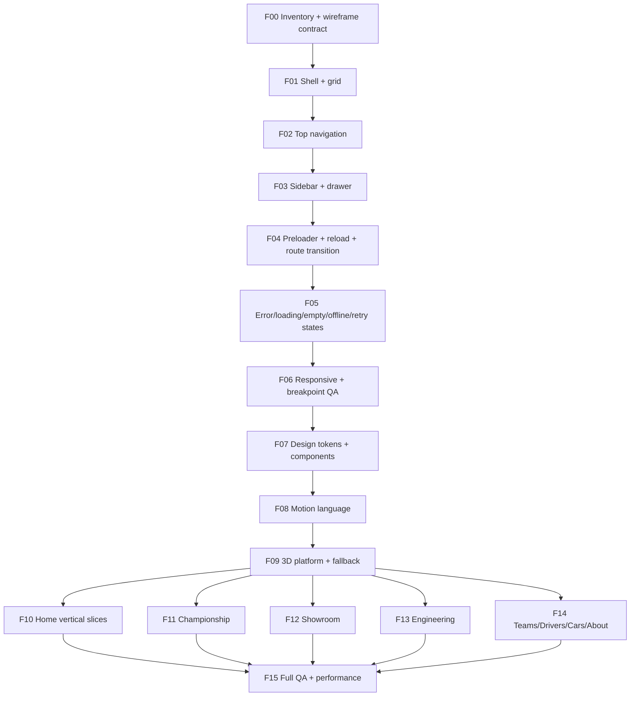

# PEDS | FRONTEND PRODUCT ROADMAP

**Goal (owner-stated):** modern, powerful Formula 1 experience with technological 3D storytelling, meaningful interaction, high-quality motion and reliable loading, recovery and responsive behavior.

**Scope of this delivery:** detailed plan only. **No visual implementation, design mockups, new libraries, API rewrite, content sync, deployment or asset replacement.** Current UI remains unchanged. This plan proposes sequence; a new visual system requires approval before changing canonical `DESIGN.md`.

## Read order for frontend work

1. `AGENTS.md` (repository rules)
2. `docs/AI_PROJECT_BLUEPRINT.md` + `docs/AI_FEATURE_FILE_MAP.md` (current routes, stack, source ownership)
3. `docs/AI_EDIT_POLICY.md` + `DESIGN.md` (file limits, asset provenance, approved boundaries)
4. `docs/frontend/00_FRONTEND_BRIEF.md` (front-end target and interaction principles)
5. `docs/frontend/01_MICROTASKS_FOUNDATION.md` (F00–F06: audit/shell/nav/sidebar/intro/states/responsive)
6. `docs/frontend/02_MICROTASKS_EXPERIENCE.md` (F07–F15: UI system/motion/3D/pages/final QA)
7. `docs/frontend/03_ACCEPTANCE_PROTOCOL.md` (quality, evidence, design approval and task state)
8. `docs/frontend/TASK_BOARD.md` (unchecked task tracker)
9. `docs/AI_DEVELOPMENT_WORKFLOW.md` (actual code/test/CI/branch-gate process)

## Dependency diagram

Ordering is an execution recommendation; tasks may be reprioritized only with a documented dependency plan. Motion/3D must not be foundational requirements for a working site.

## Quick milestones

- **M0 — Approved plan and baseline:** F00.
- **M1 — Website shell functional:** F01–F03.
- **M2 — Reliable runtime UX:** F04–F06. This is the first **fully usable skeleton** checkpoint.
- **M3 — Cohesive design system:** F07–F08.
- **M4 — Progressive 3D engine:** F09.
- **M5 — Route-by-route visual redesign:** F10–F14.
- **M6 — Verified finished frontend:** F15.

## Decision policy

The user specified **modern + powerful + F1 + interactive + animated + 3D**, which is a clear **direction**, not final colors, spacing, side rail behavior or wireframes. The final visual solution is proposed and reviewed in F00; no legacy V7/V9 code name is a new design approval.

Every step: plan exact file allowlist → read source → implement smallest diff → focused tests → full applicable gates → browser QA → verify local/remote `rebuild` → record evidence/status.

**Microtask count:** 241 across 16 phases. All remain TODO as of creation, regardless of existing components.
