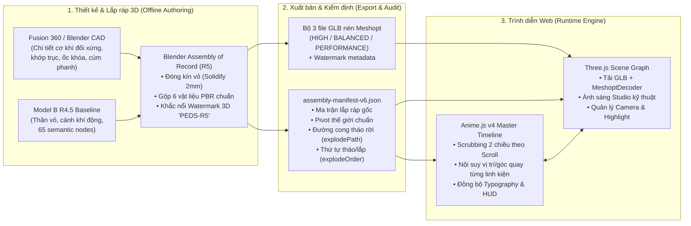

# P1 — Hợp Đồng Kỹ Thuật Pipeline: CAD / Blender → GLB + Manifest v6 → Three.js + Anime.js

**Trạng thái:** Đặc tả kiến trúc chuẩn (Phase P1)  
**Áp dụng cho:** Bản nâng cấp lắp ráp Model B (`R5`) và trình diễn tương tác trên Podium Effet De Sol.

---

## 1. Kiến trúc Pipeline Tổng thể



### Nguyên tắc Bất biến (Core Architectural Rules)

1. **Không sửa tọa độ lắp ráp bằng tay trong code React/TypeScript:** Mọi vị trí gốc (`originalLocalMatrix`), tâm xoay (`pivotWorld`), hướng và thứ tự tháo rời đều phải xuất phát từ Blender/CAD và được ghi vào `assembly-manifest-v6.json`.
2. **Tách biệt hoàn toàn Thiết kế cơ khí và Điều khiển hiệu ứng:**
   - **Fusion / Blender CAD** chịu trách nhiệm về độ kín hình học, tính đối xứng trái–phải, mặt bích lắp ghép và vật liệu.
   - **Three.js** chịu trách nhiệm hiển thị hình học 3D, đổ bóng PBR, raycasting và ma trận camera.
   - **Anime.js v4** chịu trách nhiệm điều phối thời gian (timeline scrubbing theo cuộn trang thuận/nghịch) cho cả các node 3D lẫn giao diện thuyết minh kỹ thuật.
3. **Bảo vệ tài sản gốc (RED Boundary):** Tuyệt đối không ghi đè lên `apps/web/public/models/model-b-eds-optimized-v1.glb`. Bộ GLB lắp ráp mới được quản lý theo namespace định danh riêng có kiểm tra mã băm SHA-256.

---

## 2. Quy chuẩn Hệ Tọa Độ, Đặt Tên Node & Đóng Kín Hình Học (P2 Spec)

### 2.1. Quy ước Hệ Tọa Độ & Đơn Vị

- **Đơn vị chuẩn:** `1.0 unit = 1.0 mét (m)` (trong Fusion thiết kế theo `mm` với tỷ lệ xuất `0.001 m/mm`).
- **Tâm gốc của xe (`EDS_CAR_ROOT`):** Đặt tại mặt phẳng đáy sàn xe (`Z = 0`), trục giữa dọc thân xe (`Y = 0`).
- **Sửa sai lệch đối xứng phát hiện ở R4.5:**
  - Bánh trước trái và phải phải đối xứng tuyệt đối qua mặt phẳng `Y = 0`: `pivotWorld.x = +1.2662 m`, `pivotWorld.y = ±0.8303 m`, `pivotWorld.z = +0.3711 m`.
  - Bánh sau trái và phải phải đối xứng tuyệt đối qua mặt phẳng `Y = 0`: `pivotWorld.x = -2.1441 m`, `pivotWorld.y = ±0.7775 m`, `pivotWorld.z = +0.3609 m`.
  - Cánh trước và cánh sau có `pivotWorld.y = 0.0000 m`.
  - Các cụm thân vỏ (`COCKPIT_HALO`, `LEFT_SIDEPOD`, `RIGHT_SIDEPOD`, `FLOOR_DIFFUSER`) phải có `pivotWorld` đặt tại **tâm hình học (bounding-box center hoặc tâm chốt gá)** của chính cụm đó thay vì `[0, 0, 0]`.

### 2.2. Tiêu chuẩn Đóng Kín Vỏ (Closed-Solid Shell Requirement)

- Mọi linh kiện thuộc nhóm `SOLIDIFY_SHELL` (13 linh kiện vỏ hông, Halo, sàn và khuếch tán) phải thỏa mãn:
  - Không còn cạnh biên hở (0 non-manifold open boundary edges trên vùng nhìn thấy khi tách rời).
  - Độ dày thành vỏ carbon tối thiểu: `2.0 mm` (`0.002 m`) đối với vỏ sidepod, `3.5 mm` (`0.0035 m`) đối với tấm sàn đáy và vách khuếch tán.
  - Mặt trong của vỏ tháo rời được gán vật liệu `PEDS_Carbon_Weave_Matte` để khi lật/tách ra dưới ánh sáng studio tạo cảm giác tấm sợi carbon đúc khuôn thật.

---

## 3. Hệ Thống 6 Vật Liệu PBR Chuẩn Hóa (P3 Material Consolidation Spec)

Trong bản R4.5 hiện có **10 vật liệu** bị trùng lặp tên và sắc độ giữa phần gốc và phần dựng thêm (`PEDS_Crimson_Accent` vs `PEDS_NEW_CRIMSON`, `PEDS_Titanium_Satin` vs `PEDS_NEW_TITANIUM`, `PEDS_Graphite_Auto_Paint` vs `PEDS_NEW_GRAPHITE`).

Ở Phase P3, toàn bộ 65 linh kiện phải được gộp và chuẩn hóa về đúng **6 vật liệu PBR duy nhất**:

| STT | Mã Vật Liệu Chuẩn (R5)  | Gộp từ các vật liệu cũ (R4.5)                   | Base Color (Hex / sRGB)                 | Metallic        | Roughness       | Clearcoat / Đặc tính                              | Bộ phận áp dụng                                                        |
| --- | ----------------------- | ----------------------------------------------- | --------------------------------------- | --------------- | --------------- | ------------------------------------------------- | ---------------------------------------------------------------------- |
| 1   | `PEDS_Body_Graphite`    | `PEDS_Graphite_Auto_Paint`, `PEDS_NEW_GRAPHITE` | `#1C1F24`                               | `0.45`          | `0.26`          | `Clearcoat: 0.65`, `ClearcoatRoughness: 0.12`     | Vỏ ngoài Monocoque, vỏ ngoài Sidepod, mặt cánh chính.                  |
| 2   | `PEDS_Carbon_Weave`     | `PEDS_Carbon_Composite`                         | `#121417`                               | `0.15`          | `0.42`          | `Normal scale: 0.35` (bề mặt sợi carbon kỹ thuật) | Sàn xe, bộ khuếch tán, tấm biên cánh, càng treo, hộp số, mặt trong vỏ. |
| 3   | `PEDS_Titanium_Satin`   | `PEDS_Titanium_Satin`, `PEDS_NEW_TITANIUM`      | `#8C929AC0` (`#8C929A`)                 | `0.88`          | `0.32`          | Phản xạ kim loại gia công CNC mờ                  | Khung Halo chính, moay-ơ, bán trục sau, trụ đỡ, chốt gá, ốc khóa.      |
| 4   | `PEDS_Alloy_Gunmetal`   | `PEDS_Gunmetal_Satin`                           | `#4A5058`                               | `0.82`          | `0.38`          | Nhôm/hợp kim đúc                                  | Thân máy V6, vỏ turbo, lõi & khung két tản nhiệt, mặt lắp moay-ơ.      |
| 5   | `PEDS_Crimson_Anodized` | `PEDS_Crimson_Accent`, `PEDS_NEW_CRIMSON`       | `#C81E32`                               | `0.70`          | `0.24`          | Nhôm anod đỏ sẫm kỹ thuật (Podium EDS Accent)     | Cùm phanh, đai ốc khóa tâm, đầu nối nhanh ống làm mát, điểm nhấn cánh. |
| 6   | `PEDS_Tire_And_Brake`   | `PEDS_Tire_Rubber`, `PEDS_NEW_BRAKE_CARBON`     | `#161719` (Lốp) / `#232122` (Đĩa phanh) | `0.05` / `0.25` | `0.78` / `0.55` | Cao su mờ & đĩa gốm-carbon                        | Lốp xe và 4 đĩa phanh carbon.                                          |

---

## 4. Đặc tả Schema `assembly-manifest-v6.json`

Để giải quyết triệt để hiện tượng **mesh xuyên qua nhau khi tháo rời** và cung cấp dữ liệu cho Anime.js, schema Manifest v6 giữ nguyên tính tương thích ngược với v5 (`r4.5`) và bổ sung các trường điều khiển cơ khí sau cho mỗi Assembly / Component:

```json
{
  "schema": "peds.inside-the-machine.full-vehicle-assembly.v6.r5",
  "version": "R5.0",
  "watermark": {
    "signature": "PEDS-PROPRIETARY-R5",
    "embossedNodes": [
      "PEDS_BRAKE_CALIPER",
      "PEDS_FR_BRAKE_CALIPER",
      "PEDS_RL_BRAKE_CALIPER",
      "PEDS_RR_BRAKE_CALIPER",
      "PEDS_WHEEL_HUB",
      "PEDS_R42_REV1_EXTERIOR_UNDERTRAY_SHELL_CONTROL"
    ]
  },
  "componentMechanicalSpec": {
    "id": "FRONT_LEFT_WHEEL.CENTER_LOCK_NUT",
    "explodeOrder": 1,
    "disassemblyWindow": [0.0, 0.28],
    "explodeKeyframes": [
      { "t": 0.0, "offset": [0.0, 0.0, 0.0], "eulerDeg": [0, 0, 0] },
      { "t": 0.4, "offset": [0.0, 0.12, 0.0], "eulerDeg": [0, -360, 0] },
      { "t": 1.0, "offset": [0.0, 0.34, 0.0], "eulerDeg": [0, -720, 0] }
    ],
    "isClosedSolid": true,
    "matesWith": "FRONT_LEFT_WHEEL.WHEEL_HUB",
    "canonicalMaterial": "PEDS_Crimson_Anodized"
  }
}
```

### Ý nghĩa của `explodeOrder` và `explodeKeyframes`

- **Tháo rời theo đúng trình tự cơ khí ngoài đời thực:**
  - Ví dụ ở cụm bánh xe: (1) `CENTER_LOCK_NUT` xoay tháo ra trước (`t: 0.00 -> 0.28`) → (2) `WHEEL_OUTER` rút khỏi trục (`t: 0.20 -> 0.55`) → (3) `BRAKE_CALIPER` và `BRAKE_DISC` tách ra (`t: 0.45 -> 0.80`) → (4) `WHEEL_HUB` và `SUSPENSION_LINKS` lộ diện (`t: 0.65 -> 1.00`).
  - Ví dụ ở cụm thân xe: `EXTERIOR_SHELL` của Sidepod phải nhấc ra ngoài trước (`t: 0.00 -> 0.45`) rồi cụm `COOLING_LEFT/RIGHT` bên trong mới trượt ra (`t: 0.40 -> 1.00`) — **tuyệt đối không để két nước xuyên qua lớp vỏ đang đóng**.
- Khi cuộn ngược trang (scroll up), Anime.js chạy ngược tiến trình `t` từ `1.0 → 0.0`, các bộ phận tự động lắp lại theo thứ tự ngược lại: két nước vào trước → vỏ sidepod đóng lại sau; moay-ơ/phanh vào trước → bánh xe lắp vào → đai ốc khóa tâm xoay siết lại cuối cùng.

---

## 5. Thiết kế Điều khiển Thực thi Three.js + Anime.js v4 (P4 Spec)

Hiện tại `apps/web/src/dev/insideMachineI1/App.tsx` và `ThreeStage.tsx` đang tính toán tay trong `requestAnimationFrame`. Ở Phase P4, kiến trúc điều khiển sẽ chuyển sang **một Master Timeline của `animejs` (v4)** đã có sẵn trong `package.json`:

```typescript
// Kiến trúc mẫu cho InsideMachineTimelineController (Phase P4)
import { createTimeline } from "animejs";

export interface TimelineState {
  scrollProgress: number; // 0..1
  cameraPosX: number;
  cameraPosY: number;
  cameraPosZ: number;
  cameraTargetX: number;
  cameraTargetY: number;
  cameraTargetZ: number;
  hudCalloutOpacity: number;
}

export function buildMasterAssemblyTimeline(manifest: AssemblyManifestV6) {
  const tl = createTimeline({
    autoplay: false,
    defaults: { ease: "inOutQuad" },
  });

  // 1. Đăng ký track cho từng cụm và từng linh kiện theo disassemblyWindow
  for (const comp of manifest.components) {
    // Nội suy vị trí & góc xoay theo explodeKeyframes
    // ...
  }

  // 2. Đồng bộ trực tiếp với vị trí cuộn trang (thuận và nghịch)
  return {
    seekProgress(normalizedScroll: number) {
      const clamped = Math.max(0, Math.min(1, normalizedScroll));
      tl.seek(clamped * tl.duration);
    },
  };
}
```

### Ngân sách Hiệu năng & Kiểm thử Tự động (P5 Gate)

- **Dung lượng GLB mục tiêu (đã nén Meshopt):**
  - `HIGH`: `≤ 3.2 MB`
  - `BALANCED`: `≤ 2.6 MB`
  - `PERFORMANCE`: `≤ 2.2 MB`
- **Số lượng Draw Calls:** `≤ 90` (nhờ gộp 10 vật liệu xuống 6 vật liệu chuẩn).
- **Kiểm tra không xuyên cắt (Zero-Interpenetration Gate):** Script kiểm tra bounding-box và khoảng cách mặt giữa các linh kiện con trong cùng một cụm tại mọi mốc `t = 0.0, 0.25, 0.5, 0.75, 1.0`.
