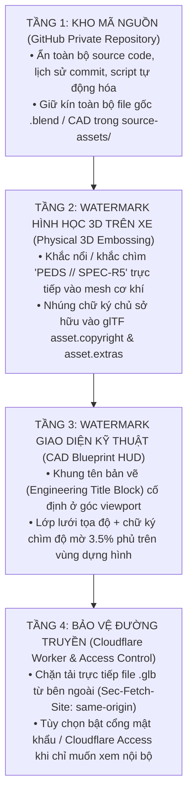

# P1 — Đặc Tả Hệ Thống Watermark 3 Lớp, Bảo Vệ Tài Sản 3D & Quy Trình Khóa GitHub Private

**Trạng thái:** Đặc tả thiết kế bảo mật & bản quyền (Phase P1)  
**Mục tiêu:** Đảm bảo sau khi hoàn thiện trang web và khóa kho mã nguồn GitHub, toàn bộ công sức thiết kế lắp ráp 3D và giao diện kỹ thuật đều mang dấu ấn định danh của **Podium Effet De Sol**, chống sao chép trái phép cả ở cấp độ quay màn hình lẫn trích xuất file 3D.

---

## 1. Tổng quan Kiến trúc Bảo vệ 4 Tầng



---

## 2. Thiết kế Chi Tiết 3 Lớp Watermark

### Lớp 1 — Watermark Giao diện kiểu Bản Vẽ Kỹ Thuật (CAD Blueprint HUD Stamp)

Thay vì đóng dấu chữ mờ thông thường gây mất thẩm mỹ, watermark trên giao diện được thiết kế như **khung thông tin của phần mềm CAD chuyên nghiệp (Autodesk Fusion / CATIA Title Block)**:

1. **Khung Bản Vẽ Kỹ Thuật (Corner Engineering Title Block):**
   - Vị trí: Góc dưới bên phải của khung nhìn 3D (`position: fixed`, `pointer-events: none`, `z-index: 30`).
   - Nội dung hiển thị:
     - Logo chính thức của **PODIUM — EFFET DE SOL** (giữ nguyên tỷ lệ chuẩn theo `DESIGN.md`).
     - Mã bản vẽ: `ASSY DWG: PEDS-MB-R5-REV01`
     - Trạng thái: `PROPRIETARY ENGINEERING BUILD // DO NOT REDISTRIBUTE`
     - Thông số thời gian thực nhảy theo cuộn trang: `EXPLODE RATIO: 00.0% → 100.0%`, `ACTIVE NODE`, `CAMERA FOV`.
2. **Lớp Lưới Tọa Độ & Dấu Chìm Vi Mô (Micro-Grid Overlay):**
   - Một lớp SVG tĩnh độ mờ cực thấp (`opacity: 0.035` ở chế độ tối) nằm đè lên vùng `<canvas>` của Three.js nhưng nằm dưới các thẻ chữ thuyết minh.
   - Chứa các đường gióng thước kỹ thuật (crosshair ticks) kèm dòng ký hiệu lặp chéo: `PODIUM EFFET DE SOL • MODEL B R5 ASSEMBLY`.
   - **Tác dụng:** Khi trải nghiệm bình thường, người xem cảm nhận đây là mặt kính ngắm của phần mềm kỹ thuật; nhưng nếu bất kỳ ai quay video màn hình hoặc chụp ảnh cắt cúp đều không thể xóa bỏ dấu bản quyền này.

### Lớp 2 — Watermark Khắc Nổi / Khắc Chìm Trực Tiếp Trên Linh Kiện 3D (3D Geometry Stamp)

Được thực hiện ngay trong Phase P2/P3 khi chuẩn hóa mesh trong Blender/CAD:

| Vị trí khắc 3D              | Node mục tiêu                                    | Kiểu khắc                                         | Nội dung khắc                                  | Khi nào người xem nhìn thấy?                                       |
| --------------------------- | ------------------------------------------------ | ------------------------------------------------- | ---------------------------------------------- | ------------------------------------------------------------------ |
| **Mặt ngoài 4 cùm phanh**   | `PEDS_*_BRAKE_CALIPER`                           | Dập nổi (`+0.6 mm` chiều cao chữ, vát cạnh bevel) | `PEDS // R5`                                   | Ngay khi bánh xe (`WHEEL_OUTER`) tách ra ở đầu hành trình cuộn.    |
| **Vành đai ốc khóa tâm**    | `PEDS_*_CENTER_LOCK_NUT`                         | Khắc chìm vòng cung (`-0.4 mm`)                   | `PODIUM EFFET DE SOL • TORQUE SPEC`            | Khi camera zoom cận cảnh vào thao tác tháo ốc khóa tâm.            |
| **Mặt bích moay-ơ bánh xe** | `PEDS_*_WHEEL_HUB`                               | Khắc chìm kỹ thuật (`-0.5 mm`)                    | `PEDS-HUB-R5`                                  | Khi đĩa phanh và bánh ngoài tách rời khỏi trục.                    |
| **Mặt trên tấm sàn đáy**    | `PEDS_R42_REV1_EXTERIOR_UNDERTRAY_SHELL_CONTROL` | Tấm biển thông số (builders plate) dập nổi        | `PODIUM EFFET DE SOL // GROUND EFFECT SPEC R5` | Khi tấm sàn và bộ khuếch tán hạ xuống bên dưới thân xe.            |
| **Mặt trên khối động cơ**   | `PEDS_R43_POWERTRAIN_ENGINE_BLOCK_CONTROL`       | Dập nổi trên nắp che cam                          | `PEDS V6 HYBRID STUDY`                         | Khi mở nắp buồng máy / tách vỏ hông ở chương Heart of the Machine. |

- **Chi phí hiệu năng:** Tổng số tam giác tăng thêm cho toàn bộ các chữ khắc 3D trên xe được giới hạn `≤ 1,800 triangles` (chỉ chiếm `< 1.3%` tổng ngân sách mesh) và tự động giản lược ở cấu hình `PERFORMANCE`.
- **Tác dụng bảo vệ:** Ngay cả khi có người dùng công cụ can thiệp bộ nhớ GPU để trích xuất mesh `.glb` ra khỏi trình duyệt, dấu định danh `PEDS // R5` đã nằm liền khối trong hình học của các linh kiện quan trọng nhất.

### Lớp 3 — Watermark Ẩn Trong Cấu Trúc File GLB & Provenance Hợp Pháp

1. **Nhúng Metadata chuẩn glTF 2.0 (`asset` block):**
   Trong bước xuất file `.glb` bằng script Python (`tools/inside-the-machine/authoring/export_profiles.py`), nhúng trực tiếp thông tin định danh và nguồn gốc giấy phép:
   ```json
   {
     "asset": {
       "version": "2.0",
       "generator": "Podium Effet De Sol R5 CAD-Blender Pipeline",
       "copyright": "Assembly & newly authored mechanical components (c) Podium Effet De Sol. Exterior base mesh derived from 'Formula 1 2022 Car' by Luis Adrian V. (CC BY 4.0).",
       "extras": {
         "pedsBuildId": "PEDS-ITM-R5",
         "pedsWatermarkHash": "<SHA256-SIGNATURE>",
         "redistribution": "PROHIBITED_WITHOUT_ATTRIBUTION"
       }
     }
   }
   ```
2. **Tuân thủ trọn vẹn giấy phép CC BY 4.0 của Model B gốc:**
   - Theo `DESIGN.md` và `docs/asset-licenses.md`, phần vỏ ngoài của Model B dựa trên mô hình "Formula 1 2022 Car" của Luis Adrian V. theo giấy phép **CC BY 4.0**.
   - Việc đóng dấu Watermark của **Podium Effet De Sol** sẽ ghi rõ là **bản quyền thiết kế cấu trúc lắp ráp, các linh kiện cơ khí dựng mới và giao diện kỹ thuật PEDS R5**, đồng thời vẫn giữ đầy đủ dòng ghi công tác giả gốc trong bảng thông tin (Attribution Modal / Footer) đúng quy định pháp lý.

---

## 3. Bảo vệ Đường Truyền Tải File `.glb` (Worker Asset Guard)

Khi trang web chạy thực tế, để ngăn người lạ mở tab mạng (Network) copy đường dẫn `.glb` đem đi tải lẻ bằng `curl` hoặc trình duyệt khác:

1. **Kiểm tra Header `Sec-Fetch-Site` và `Sec-Fetch-Dest` tại Cloudflare Worker (`apps/api`):**
   - Chỉ phục vụ các file mô hình lắp ráp khi request có `Sec-Fetch-Site: same-origin` (hoặc được gọi trực tiếp từ ứng dụng web của cùng tên miền).
   - Chặn các request điều hướng trực tiếp từ thanh địa chỉ trình duyệt (`Sec-Fetch-Mode: navigate` / `Sec-Fetch-Dest: document`) vào đường dẫn `.glb`.
2. **Header chống lập chỉ mục và lưu trữ bên thứ ba:**
   - Gắn header `X-Robots-Tag: noindex, noimageindex, nosnippet` và `Cache-Control: private, max-age=3600` cho các route chứa tài sản lắp ráp R5.

---

## 4. Quy Trình Khóa Kho Mã Nguồn GitHub (Private Repository Checklist)

Sau khi hoàn tất các giai đoạn phát triển hoặc bất cứ lúc nào anh muốn khóa kho mã nguồn trên GitHub (`DB-Ducbao113/Podium-Effet-De-Sol`), thực hiện theo đúng trình tự sau để an toàn tuyệt đối:

1. **Chuyển trạng thái Repository sang Private:**
   - Vào **GitHub Repository → Settings → General → Danger Zone → Change repository visibility → Change to private**.
   - Khi chuyển sang Private: toàn bộ mã nguồn, các nhánh (`rebuild`, `feat/engineering-inside-machine-v2`, `migration/clean-architecture`), lịch sử commit và các file trong `source-assets/` sẽ lập tức ẩn khỏi công chúng và công cụ tìm kiếm.
2. **Kiểm tra & Thu hồi các bản Fork hoặc GitHub Pages (nếu có):**
   - Trong **Settings → Pages**, đảm bảo GitHub Pages đang ở trạng thái **Disabled / Unpublish** (vì dự án dùng kiến trúc Vite + Cloudflare Worker riêng).
   - Trong **Settings → Actions → General**, đặt quyền truy cập Artifact/Workflow ở mức nội bộ (Private).
3. **Tùy chọn Khóa Cổng Truy Cập Website (Nếu chỉ muốn xem cá nhân hoặc gửi riêng cho đối tác):**
   - Nếu anh muốn ngay cả đường link website sau khi deploy cũng chỉ mở được khi có mật khẩu, bật **Cloudflare Zero Trust Access (One-time PIN / Password)** phía trước domain của Worker — hoàn toàn miễn phí và chặn từ tầng mạng trước khi bất kỳ file HTML, JS hay `.glb` nào được tải về.
